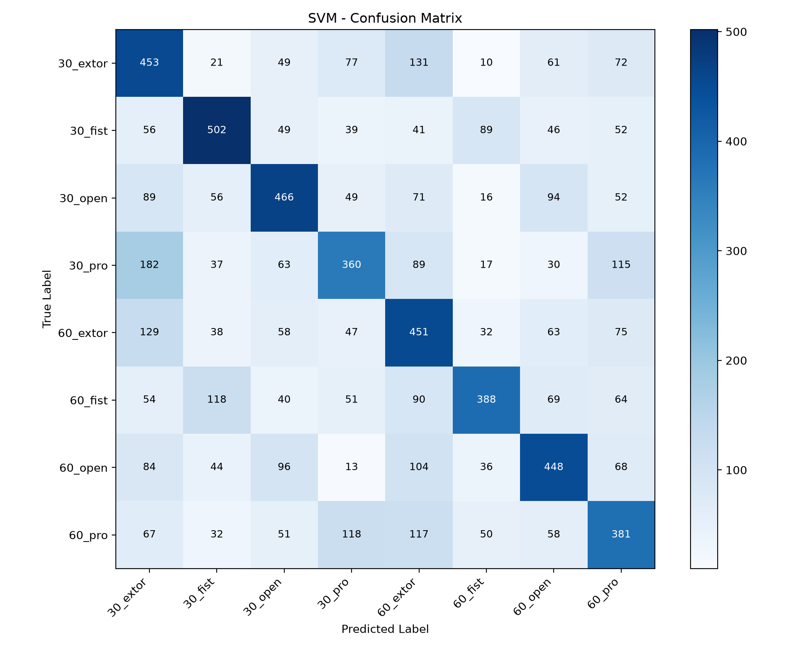
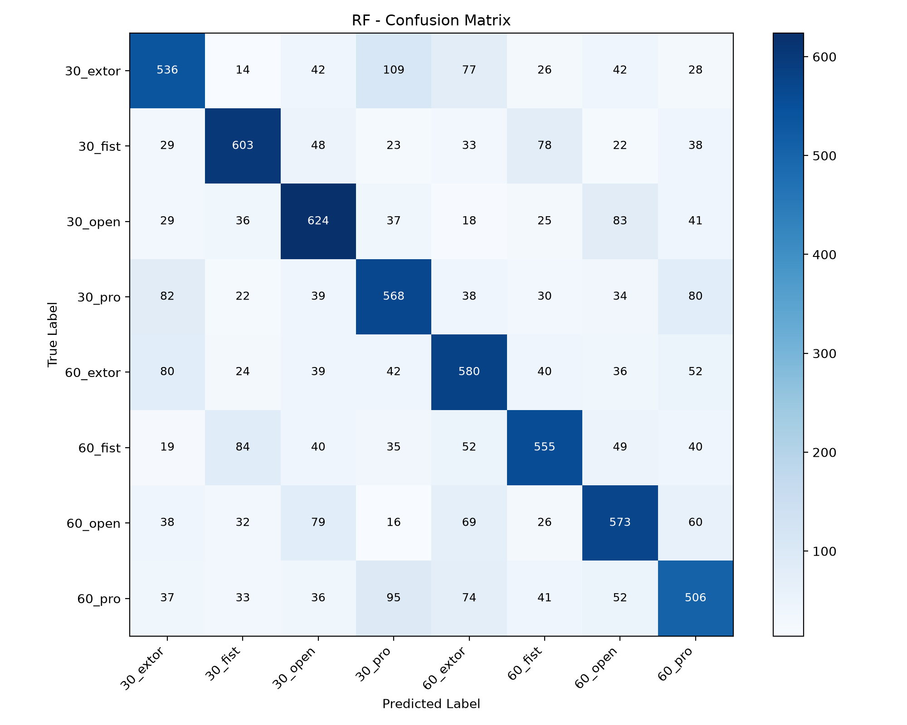
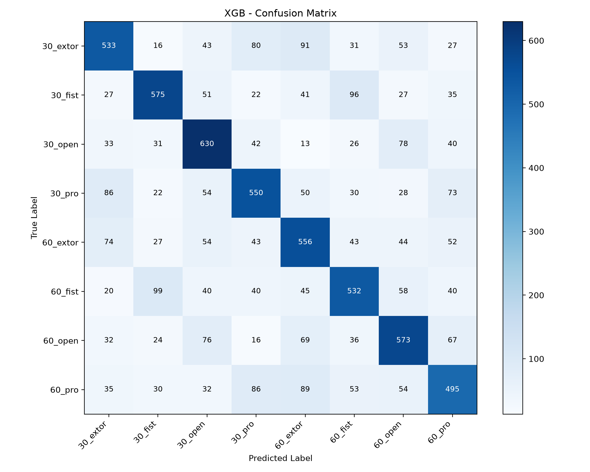

# sEMG 기반 손동작 및 팔꿈치 각도 분류 프로젝트

## 1. 코드 설명

### 1.1 프로젝트 개요

본 프로젝트는 표면 근전도(sEMG, Surface Electromyography) 신호를 활용하여 손동작과 팔꿈치 각도를 분류하기 위한 머신러닝 프로젝트이다.

sEMG 신호는 근육의 전기적 활동을 측정한 데이터로, 손동작 및 팔꿈치 각도에 따라 서로 다른 신호 특성이 나타날 수 있다.

본 실습에서는 sEMG 데이터에 필터링, 시행 구간 추출, 슬라이딩 윈도우 및 시간 영역 특징 추출을 적용하여 머신러닝 모델 학습에 사용할 데이터셋을 구성하였다.

이후 SVM, Random Forest, XGBoost 모델을 학습시키고 분류 성능과 Confusion Matrix를 비교하였다.

### 1.2 사용 데이터

- **데이터셋:** sEMG Hand Gesture Elbow Angle Dataset
- **데이터 출처:** [GitHub 데이터셋](https://github.com/TestUser-alt-dev/sEMG-Hand-Gesture-Elbow-Angle-Dataset)
- **데이터 형식:** CSV 파일
- **전체 파일 수:** 64개
- **sEMG 채널 수:** 5개
- **샘플링 주파수:** 1000Hz
- **분류 클래스:** 총 8개

분류 대상은 팔꿈치 각도 30°와 60°에서 수행한 네 가지 손동작(extor, fist, open, pro)의 조합으로 구성하였다.

| 팔꿈치 각도 | 손동작 | 클래스 |
|---|---|---|
| 30° | extor | `30_extor` |
| 30° | fist | `30_fist` |
| 30° | open | `30_open` |
| 30° | pro | `30_pro` |
| 60° | extor | `60_extor` |
| 60° | fist | `60_fist` |
| 60° | open | `60_open` |
| 60° | pro | `60_pro` |

### 1.3 데이터 전처리 방법

1. **노치 필터(Notch Filter):** 60Hz 전원 잡음 성분을 감소시키기 위해 적용하였다.
2. **대역통과 필터(Bandpass Filter):** 20~450Hz 주파수 대역을 통과시켜 분석 대상 신호를 추출하였다.
3. **시행 구간 추출:** `mark` 값을 기준으로 시행을 구분하고, 각 시행에서 1.5~3.5초에 해당하는 2초 구간을 추출하였다.
4. **슬라이딩 윈도우:** 200ms 윈도우와 100ms 이동 간격(50% 오버랩)을 적용하여 시행당 19개 윈도우를 생성하였다.
5. **시간 영역 특징 추출:** RMS, MAV, WL, ZC, SSC의 다섯 가지 특징을 5개 채널에서 계산하여 25차원 특징 벡터를 생성하였다.
6. **데이터 분할 및 표준화:** 최종 실험에서는 시행 단위로 학습 데이터와 테스트 데이터를 먼저 분할한 후 특징을 생성하고, 학습 데이터 기준으로 `StandardScaler`를 적용하였다.

**사용한 시간 영역 특징**

| 특징 | 설명 |
|---|---|
| RMS (Root Mean Square) | 신호의 제곱평균제곱근 |
| MAV (Mean Absolute Value) | 신호 절댓값의 평균 |
| WL (Waveform Length) | 연속된 신호값 사이의 변화량 합계 |
| ZC (Zero Crossing) | 신호의 영점 교차 횟수 |
| SSC (Slope Sign Changes) | 신호 기울기의 부호 변화 횟수 |

각 윈도우에서 5개 채널별로 5가지 특징을 추출하므로 최종 특징 벡터는 25차원으로 구성된다.

### 1.4 학습 및 테스트 방법

본 프로젝트에서는 데이터 분할 방식에 따른 모델 성능 차이를 확인하기 위해 CSV 파일 단위 분할과 시행(Trial) 단위 분할을 각각 적용하였다.

**초기 실험: CSV 파일 단위 분할**

초기 실험에서는 전체 64개 CSV 파일을 학습용 51개와 테스트용 13개로 분할하였다.

| 구분 | 학습 데이터 | 테스트 데이터 |
|---|---:|---:|
| CSV 파일 수 | 51개 | 13개 |
| 특징 벡터 수 | 28,101개 | 7,163개 |
| 특징 차원 | 25차원 | 25차원 |

초기 데이터셋은 `dataset.npz`로 저장하였다.

**최종 실험: 시행 단위 분할**

최종 모델 성능 평가에서는 개별 시행을 먼저 추출한 후 학습 데이터와 테스트 데이터를 80:20 비율로 분할하였다.

동일 시행에서 생성된 윈도우가 학습과 테스트에 동시에 포함되지 않도록 시행 단위 분할을 적용하였다.

| 구분 | 학습 데이터 | 테스트 데이터 |
|---|---:|---:|
| 시행 수 | 1,484개 | 372개 |
| 특징 벡터 수 | 28,196개 | 7,068개 |
| 특징 차원 | 25차원 | 25차원 |
| 클래스 수 | 8개 | 8개 |

- **분할 비율:** 학습 80%, 테스트 20%
- **분할 방법:** `train_test_split()` 및 클래스별 층화 추출(`stratify`)
- **랜덤 시드:** 42
- **표준화 방법:** `StandardScaler`

표준화에 필요한 평균과 표준편차는 학습 데이터에서만 계산하였으며, 테스트 데이터에는 동일한 변환 기준을 적용하였다.

최종 데이터셋은 `dataset_trial_split.npz`로 저장하였다.

단, 동일 참가자의 서로 다른 시행이 학습과 테스트에 포함될 수 있으므로 참가자 독립적인 성능 평가 결과는 아니다.

### 1.5 사용 모델

본 프로젝트에서는 다음 세 가지 머신러닝 모델을 사용하였다.

**SVM (Support Vector Machine)**

- RBF 커널을 사용하였다.
- 비선형 결정 경계를 통해 sEMG 특징 벡터를 분류하였다.
- 주요 설정: `kernel='rbf'`, `C=1`, `gamma='scale'`

**Random Forest**

- 여러 결정 트리의 예측을 결합하는 앙상블 모델이다.
- 특징 간 비선형적인 관계를 학습하여 분류를 수행하였다.
- 주요 설정: `n_estimators=100`, `random_state=42`

**XGBoost**

- 부스팅 기반의 결정 트리 앙상블 모델이다.
- 이전 트리의 예측 오류를 보완하는 방식으로 학습을 진행하였다.
- 주요 설정: `n_estimators=400`, `max_depth=6`, `learning_rate=0.05`, `subsample=0.9`, `colsample_bytree=0.8`

### 1.6 코드 실행 방법

**개발 환경 및 사용 라이브러리**

- Python
- Visual Studio Code
- NumPy
- SciPy
- scikit-learn
- XGBoost
- Matplotlib

**실행 방법**

프로젝트 폴더에 `data` 디렉터리를 준비하고 필요한 라이브러리를 설치한다.

```bash
pip install numpy scipy scikit-learn xgboost matplotlib
```

기초 전처리 및 특징 추출 실습은 다음 파일로 구성된다.

```bash
python week2_step1.py
python week2_step2.py
python week2_step3.py
python week2_step4.py
python week2_step5.py
python week2_step6.py
```

최종 시행 단위 데이터셋 생성과 모델 성능 평가는 다음 순서로 진행한다.

```bash
python check_trial_split.py
python week3_readme.py
python confusion_matrix.py
```

`check_trial_split.py` 실행 시 최종 데이터셋인 `dataset_trial_split.npz`가 생성된다.

`week3_readme.py`에서는 세 모델의 Accuracy, Precision, Recall, F1-score를 계산하며, `confusion_matrix.py`에서는 모델별 혼동행렬을 생성한다.

### 1.7 코드 파일 설명

| 파일 | 설명 |
|---|---|
| `week2_step1.py` | 60Hz 노치 필터 및 20~450Hz 대역통과 필터 적용 |
| `week2_step2.py` | `mark` 기준 시행 구분 및 2초 신호 구간 추출 |
| `week2_step3.py` | 200ms 윈도우 및 50% 중첩을 이용한 데이터 분할 |
| `week2_step4.py` | RMS, MAV, WL, ZC, SSC 시간 영역 특징 추출 |
| `week2_step5.py` | CSV 파일 단위 학습·테스트 분할 및 특징 데이터 생성 |
| `week2_step6.py` | 기초 실습 데이터셋 구성 및 확인 |
| `check_trial_split.py` | 시행 단위 데이터 분할 및 최종 특징 데이터셋 생성 |
| `check_rms.py` | 시행별 RMS 변화 확인 |
| `check_segment.py` | 분석 구간 변경 데이터셋 생성 |
| `compare_segments.py` | 분석 구간별 내부 검증 성능 비교 |
| `week3_readme.py` | SVM, Random Forest, XGBoost 학습 및 성능 비교 |
| `confusion_matrix.py` | 모델별 Confusion Matrix 생성 및 클래스별 분석 |
| `dataset.npz` | 초기 CSV 파일 단위 분할 데이터셋 |
| `dataset_trial_split.npz` | 최종 시행 단위 학습·테스트 데이터셋 |
| `images/` | 모델별 Confusion Matrix 이미지 저장 폴더 |

---

## 2. 모델 성능 비교

동일한 시행 단위 학습·테스트 데이터셋을 사용하여 SVM, Random Forest, XGBoost 모델의 분류 성능을 비교하였다.

모델 성능은 Accuracy, Precision, Recall, F1-score를 사용하여 평가하였으며, Precision, Recall, F1-score는 Macro 평균을 적용하였다.

### 2.1 모델별 성능 비교

| 모델 | Accuracy | Precision | Recall | F1-score |
|---|---:|---:|---:|---:|
| SVM | 48.80% | 49.75% | 48.80% | 48.93% |
| **Random Forest** | **64.30%** | **64.36%** | **64.29%** | **64.30%** |
| XGBoost | 62.87% | 62.94% | 62.86% | 62.85% |

### 2.2 성능 비교 분석

세 모델 중 Random Forest가 정확도 64.30%, F1-score 64.30%로 가장 높은 성능을 기록하였다.

XGBoost는 정확도 62.87%로 Random Forest보다 1.43%p 낮았으며, SVM은 48.80%로 가장 낮은 정확도를 기록하였다.

Random Forest와 XGBoost는 모두 결정 트리 기반 앙상블 모델로, 이번 실험에서 SVM보다 높은 분류 성능을 나타냈다.

특히 Random Forest는 Accuracy, Precision, Recall, F1-score의 모든 지표에서 가장 높은 값을 기록하였다.

다만 별도의 하이퍼파라미터 최적화나 반복 교차검증을 수행하지 않았으므로, 현재 결과만으로 모델 간 일반적인 성능 우열을 단정하기는 어렵다.

---

## 3. Confusion Matrix 분석

각 모델의 분류 성능을 클래스별로 분석하기 위해 Confusion Matrix(혼동행렬)를 생성하였다.

총 8개의 클래스(팔꿈치 각도 30°/60° × 손동작 4종)를 대상으로 실제 클래스와 모델의 예측 결과를 비교하였다.

혼동행렬의 행은 실제 클래스(True Label), 열은 예측 클래스(Predicted Label)를 나타낸다. 대각선의 값은 올바르게 분류된 샘플 수이며, 대각선 이외의 값은 오분류된 샘플 수이다.

본 실험의 혼동행렬은 시행(Trial) 단위로 분할한 테스트 데이터에서 생성된 윈도우별 예측 결과를 기준으로 한다.

### 3.1 SVM



**분석**

- **가장 잘 분류된 클래스:** `30_fist` (57.44%)
- **가장 낮은 정답률을 기록한 클래스:** `30_pro` (40.31%)
- **가장 많이 발생한 오분류:** `30_pro → 30_extor` (182개)

SVM은 전체 정확도 48.80%를 기록하여 세 모델 중 가장 낮은 성능을 보였다.

특히 `30_pro` 클래스를 `30_extor`로 잘못 예측한 경우가 182개로 가장 많았다. 두 클래스는 팔꿈치 각도가 30°로 동일하지만 손동작이 서로 다르다.

이러한 결과는 두 동작에서 추출된 시간 영역 특징이 일부 유사하여 SVM이 클래스를 명확하게 구분하지 못했을 가능성을 보여준다.

### 3.2 Random Forest



**분석**

- **가장 잘 분류된 클래스:** `30_open` (69.88%)
- **가장 낮은 정답률을 기록한 클래스:** `60_pro` (57.89%)
- **가장 많이 발생한 오분류:** `30_extor → 30_pro` (109개)

Random Forest는 전체 정확도 64.30%를 기록하여 세 모델 중 가장 높은 성능을 보였다.

특히 `30_open` 클래스에서 69.88%의 정답률을 기록하였으며, SVM보다 전반적으로 높은 분류 성능을 나타냈다.

그러나 `30_extor`를 `30_pro`로 잘못 예측한 경우가 109개 발생하였다. 두 클래스는 팔꿈치 각도는 동일하지만 손동작이 다르므로, 특정 동작 간 sEMG 특징이 유사하게 나타났을 가능성이 있다.

### 3.3 XGBoost



**분석**

- **가장 잘 분류된 클래스:** `30_open` (70.55%)
- **가장 낮은 정답률을 기록한 클래스:** `60_pro` (56.64%)
- **가장 많이 발생한 오분류:** `60_fist → 30_fist` (99개)

XGBoost는 전체 정확도 62.87%를 기록하여 Random Forest와 유사한 성능을 보였다.

특히 `30_open` 클래스에서 70.55%의 정답률을 기록하여 해당 클래스에 대해서는 Random Forest보다 높은 성능을 나타냈다.

반면 `60_fist`를 `30_fist`로 잘못 예측한 경우가 99개 발생하였다. 두 클래스는 손동작은 동일하지만 팔꿈치 각도가 다르다.

이는 동일한 손동작에서 팔꿈치 각도에 따른 sEMG 신호 차이를 모델이 충분히 구분하지 못했을 가능성을 보여준다.

### 3.4 종합 분석

세 모델의 Confusion Matrix를 비교한 결과, Random Forest가 가장 높은 전체 분류 성능을 보였으며 XGBoost가 그다음으로 높은 성능을 기록하였다.

Random Forest와 XGBoost는 모두 `30_open` 클래스에서 높은 정답률을 나타냈으나, `60_pro` 클래스에서는 상대적으로 낮은 정답률을 보였다.

또한 일부 클래스에서는 팔꿈치 각도가 같지만 손동작이 다른 경우와, 손동작은 같지만 팔꿈치 각도가 다른 경우 모두 오분류가 발생하였다.

이는 현재 사용한 RMS, MAV, WL, ZC, SSC의 25차원 시간 영역 특징만으로는 일부 손동작과 팔꿈치 각도의 차이를 충분히 구분하기 어려울 수 있음을 시사한다.

향후 주파수 영역 특징 추가, 특징 선택 및 모델 하이퍼파라미터 최적화 등을 통해 분류 성능 개선을 시도할 수 있다.

---

## 4. 최종 결과

### 4.1 실험 결과 요약

본 프로젝트에서는 sEMG 신호를 활용하여 손동작 4종과 팔꿈치 각도 2종(30°, 60°)을 조합한 총 8개 클래스를 분류하였다.

60Hz 노치 필터와 20~450Hz 대역통과 필터를 적용하였으며, 각 시행에서 2초 구간을 추출한 뒤 200ms 윈도우와 50% 오버랩을 사용하였다.

이후 RMS, MAV, WL, ZC, SSC의 시간 영역 특징을 계산하여 윈도우당 25차원 특징 벡터를 생성하였다.

시행(Trial) 단위로 학습·테스트 데이터를 분할한 후 SVM, Random Forest, XGBoost 모델의 분류 성능을 비교하였다.

| 모델 | Accuracy | Precision | Recall | F1-score |
|---|---:|---:|---:|---:|
| SVM | 48.80% | 49.75% | 48.80% | 48.93% |
| **Random Forest** | **64.30%** | **64.36%** | **64.29%** | **64.30%** |
| XGBoost | 62.87% | 62.94% | 62.86% | 62.85% |

실험 결과 Random Forest가 정확도 64.30%, F1-score 64.30%로 가장 높은 성능을 기록하였다.

XGBoost는 정확도 62.87%로 Random Forest와 비교적 유사한 성능을 보였으며, SVM은 48.80%로 가장 낮은 성능을 나타냈다.

### 4.2 모델별 성능 차이 분석

Random Forest와 XGBoost는 모두 여러 결정 트리를 활용하는 앙상블 기반 모델로, sEMG 특징 간의 비선형적인 관계를 학습할 수 있다.

이번 실험에서는 두 모델이 SVM보다 높은 성능을 기록하였으며, 특히 Random Forest가 가장 우수한 결과를 보였다.

반면 SVM은 동일한 특징과 데이터셋을 사용했음에도 상대적으로 낮은 정확도를 기록하였다.

이는 현재 적용한 RBF 커널 및 하이퍼파라미터 설정이 데이터의 복잡한 분류 경계를 충분히 표현하지 못했을 가능성이 있다.

다만 하이퍼파라미터 최적화를 별도로 수행하지 않았으므로 모델 구조 자체의 우열을 일반화하기는 어렵다.

### 4.3 초기 성능 저하 원인 분석 및 개선 과정

초기 실험에서는 CSV 파일 단위로 학습 데이터와 테스트 데이터를 분할하여 SVM, Random Forest, XGBoost 모델의 성능을 평가하였다.

그러나 초기 평가 결과 SVM 6.44%, Random Forest 8.68%, XGBoost 8.25%로 세 모델 모두 낮은 정확도를 기록하였다.

이에 따라 데이터 전처리 과정과 데이터 분할 방법을 점검하고, 시행(Trial) 단위로 데이터를 분할하는 추가 실험을 진행하였다.

| 모델 | 초기 정확도 | 최종 정확도 |
|---|---:|---:|
| SVM | 6.44% | 48.80% |
| Random Forest | 8.68% | 64.30% |
| XGBoost | 8.25% | 62.87% |

최종 실험에서는 시행 단위로 학습·테스트 데이터를 분할하고, 동일 시행에서 생성된 윈도우가 양쪽 데이터에 동시에 포함되지 않도록 구성하였다.

그 결과 Random Forest의 정확도가 64.30%로 나타났으며, SVM과 XGBoost에서도 초기 실험보다 높은 정확도를 기록하였다.

초기 CSV 파일 단위 분할은 학습 데이터와 테스트 데이터에 서로 다른 파일이 사용되므로, 파일별 신호 특성 차이가 모델 성능에 영향을 주었을 가능성이 있다. 반면 시행 단위 분할에서는 동일 파일에 포함된 서로 다른 시행이 학습과 테스트에 사용될 수 있어 평가 조건이 달라진다.

따라서 초기 정확도가 낮았던 원인을 특정 코드 오류나 데이터 분할 방식 하나로 단정하기는 어렵다. 이번 결과는 서로 다른 평가 조건에서 모델 성능이 크게 달라질 수 있음을 보여준다.

추가로 분석 구간을 비교하기 위해 1.5~3.5초와 1.0~3.0초 구간을 대상으로 내부 검증을 진행하였다.

| 분석 구간 | Accuracy | Macro F1 |
|---|---:|---:|
| **1.5~3.5초** | **62.06%** | **62.00%** |
| 1.0~3.0초 | 59.53% | 59.55% |

내부 검증에서 1.5~3.5초 구간이 더 높은 성능을 보였으므로 최종 실험에서는 해당 구간을 유지하였다.

이러한 과정을 통해 데이터 분할 방법과 신호 분석 구간의 설정이 sEMG 분류 성능 평가에 중요한 요소임을 확인하였다.

### 4.4 한계점 및 개선 방향

본 실험에서 확인한 한계점과 향후 개선 방향은 다음과 같다.

1. **분류 정확도의 한계:** 가장 높은 성능을 기록한 Random Forest도 64.30%의 정확도를 보여 일부 클래스의 분류에 어려움이 있었다.
2. **특징 추출의 한계:** RMS, MAV, WL, ZC, SSC의 시간 영역 특징만 사용하였으므로 주파수 영역 및 시간-주파수 영역 특징을 추가하여 성능 개선을 시도할 수 있다.
3. **모델 최적화 부족:** SVM, Random Forest, XGBoost에 대해 다양한 하이퍼파라미터를 비교하는 추가 실험이 필요하다.
4. **평가 방식의 한계:** 동일 참가자의 서로 다른 시행이 학습과 테스트에 포함될 수 있으므로, 새로운 참가자에 대한 일반화 성능은 별도로 검증해야 한다.
5. **추가 검증 필요:** 향후 시행 단위 교차검증을 통해 성능의 평균과 표준편차를 확인하면 모델의 안정성을 더 체계적으로 평가할 수 있다.

### 4.5 최종 결론

본 프로젝트에서는 sEMG 신호에 필터링, 슬라이딩 윈도우, 시간 영역 특징 추출을 적용하고 세 가지 머신러닝 모델의 분류 성능을 비교하였다.

실험 결과 Random Forest가 가장 높은 정확도와 F1-score를 기록하였으며, XGBoost 역시 비교적 유사한 성능을 나타냈다.

Confusion Matrix 분석에서는 일부 손동작 간 혼동과 동일 손동작의 팔꿈치 각도 간 혼동이 발생함을 확인하였다.

이를 통해 sEMG 기반 손동작 및 팔꿈치 각도 분류의 가능성을 확인하는 동시에, 데이터 분할 방식과 특징 추출 방법이 모델 평가에 중요한 영향을 미칠 수 있다는 점을 확인하였다.

향후 다양한 특징 추출 기법과 모델 최적화, 참가자 독립 평가를 적용한다면 분류 성능과 일반화 가능성을 더욱 체계적으로 검증할 수 있을 것이다.